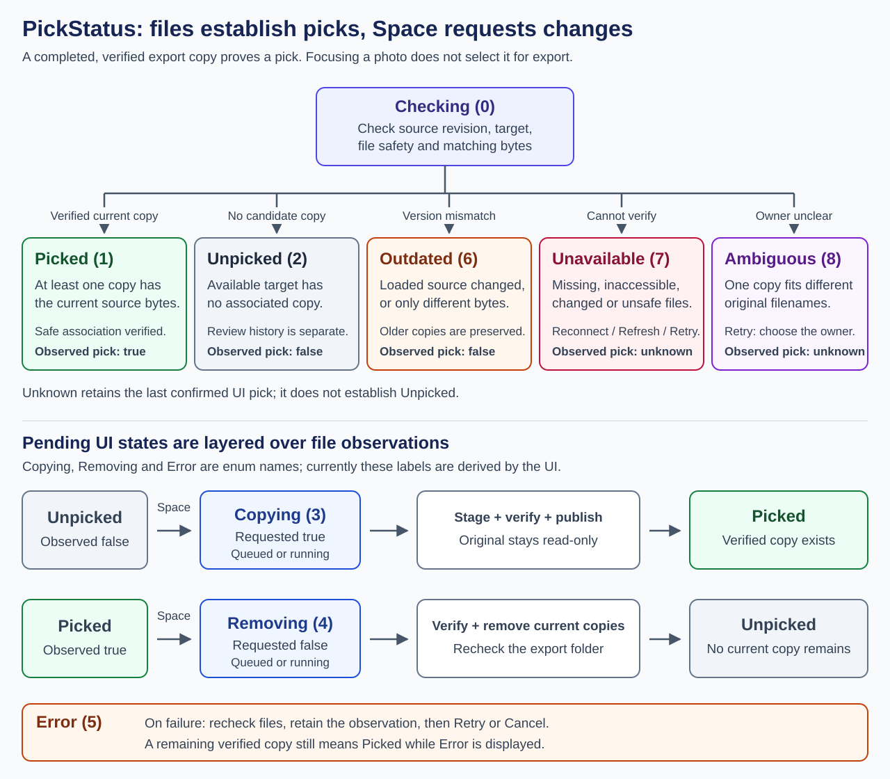
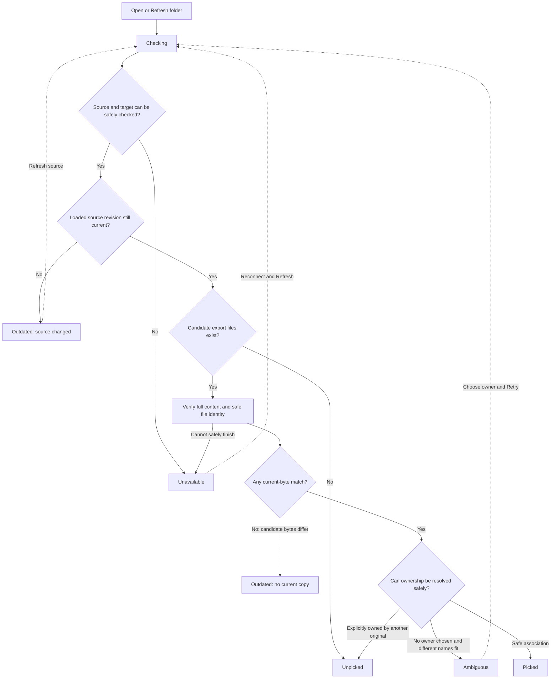
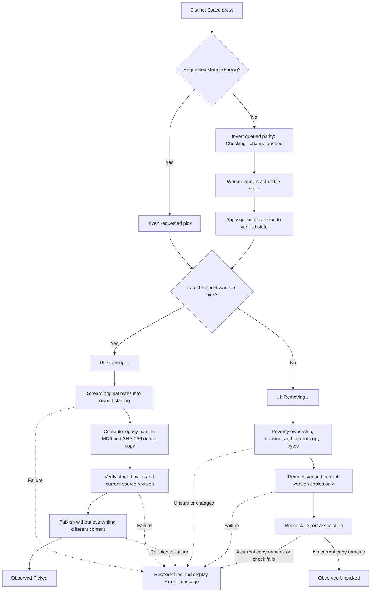

# How image selection works in PhotoScreener

**A photo is picked when the designated export folder contains a verified copy of its current bytes.** Pressing Space requests a change; background work makes the files agree with that request. Original photos stay read-only.

[Open the full-size diagram](images/pick-status-flow.svg) or its [PNG export](images/pick-status-flow.png). The diagrams below are editable Mermaid source and render directly on GitHub. The tables provide the same information when a viewer cannot render diagrams.

## Focus, requested selection, and observed selection

These are three different things:

| Concept | What it means | What changes it |
| --- | --- | --- |
| Focused photo | The photo shown in the main preview. | Left/Right, a thumbnail, or folder navigation. |
| Requested pick | The selection you want after pending work finishes. | A distinct Space press. |
| Observed pick | The last confirmed result from checking export files. | Background comparison or a completed mutation. |

Left/Right never pick or unpick. Space stays on the same photo; held-key repeats are suppressed. Space switches a Picked/Unpicked filter or Project picks back to the photo's **All** view so the active photo remains visible.

## Every `PickStatus` value

The numbers are the enum's current implicit C# values, not a selection database or persisted selection ledger.

| Value | Name | When it is used | `Observation.Picked` | What to do |
| --- | --- | --- | --- | --- |
| 0 | `Checking` | Initial row state while source/export association is being verified. Also used when a previously shared association needs a fresh check. | Unknown (`null`) | Wait for verification, or Refresh when the message requests it. Space can queue an inversion without guessing the file state. |
| 1 | `Picked` | At least one safe export copy has the same verified bytes as the current source revision. A successful pick produces this observation. | `true` | Space requests removal of its verified current-version copies. |
| 2 | `Unpicked` | The relevant export location was checked and there is no associated current copy. A successful unpick rechecks the folder before reporting this. | `false` | Space requests a copy. This does **not** mean the photo was reviewed or rejected. |
| 3 | `Copying` | The enum contains this value. Currently the UI derives **Copying…** from a pending request for `true`, rather than assigning this value to `Observation.Status`. It covers queued work as well as an active copy. | `null` if used as an observation | Wait, toggle the request again, or Cancel pending. A partial staging file is not a pick. |
| 4 | `Removing` | The enum contains this value. Currently the UI derives **Removing…** from a pending request for `false`, rather than assigning it to `Observation.Status`. | `null` if used as an observation | Wait, change the request, or Cancel pending. Existing copies remain observed Picked until the worker confirms their removal. |
| 5 | `Error` | The enum contains this value. Currently `PhotoRow.Fail()` displays **Error · message** over the latest observation; it does not replace that observation with `PickStatus.Error`. Used for failed or rejected mutations, collisions, locks, unsafe operations, or queue-limit failures. | The Error enum maps to `null`; the UI's underlying observation can still be known. | Read the message and Retry after resolving the cause, or cancel the unfinished request. A remaining verified copy still means Picked. |
| 6 | `Outdated` | The loaded source revision changed; or candidate exports exist, their bytes differ, and none matches the current version. Older/different exported bytes are preserved. | `false` | Refresh if the source changed. You can pick its current version when the resulting association is safe. |
| 7 | `Unavailable` | The source/export cannot be safely checked: disconnected storage, missing previously available target, access errors, unsafe aliases, or a file changing during verification. | Unknown (`null`) | Reconnect, correct the target/access problem, then Refresh or Retry. Unavailable is never proof that the folder is empty. |
| 8 | `Ambiguous` | One verified export could belong to **different original filenames**, such as a natural dotted name that also resembles a legacy hash-suffixed export. | Unknown (`null`) | Retry opens an ownership choice. Choose the original before allowing destructive changes. |

Only six values are currently produced as file observations in the normal flow: `Checking`, `Picked`, `Unpicked`, `Outdated`, `Unavailable`, and `Ambiguous`. `Copying`, `Removing`, and `Error` remain useful enum names, but their present UI implementation is derived text.

## Opening or refreshing a folder

The default target is that source folder's `export` child. An explicit override belongs to that source folder. Opening a folder does not create an empty export target.

A never-created export child can mean Unpicked when its storage is available. A previously available export disappearing is handled as Unavailable. Filename, length, and the short legacy suffix are only candidate hints; they do not establish a pick without content verification.

## Pressing Space

This diagram shows the normal successful path. **Copying…** and **Removing…** below are UI labels for requested state, not replacements for the current file observation.

The worker compares the latest requested state with what is already on disk. When they agree, it can finish without copying or deleting. Rapid requests are coalesced by sequence; an older result cannot overwrite a newer request. Work already performed may require reconciliation with the new intent—toggling is not an instantaneous filesystem undo.

### Examples of the two layers

| Moment | Observed pick | Requested pick | Display |
| --- | --- | --- | --- |
| No completed copy exists. | `false` | `false` | `Unpicked` |
| You press Space; copying is queued. | `false` | `true` | `Copying…` |
| Staging finishes and the verified copy is published. | `true` | `true` | `Picked` |
| You press Space again. | `true` | `false` | `Removing…` |
| A duplicate is locked, so a verified current copy remains. | `true` | `false` | `Error · message`; the observed pick remains true. |
| All current copies are removed and the folder is rechecked. | `false` | `false` | `Unpicked` |

While the initial observation is unknown, one Space press queues an inversion. Two presses cancel that queued inversion when both are coalesced before a mutation starts. The display is **Checking · change queued** for odd pending parity. The worker resolves the inversion only after it knows the actual state.

## Shared targets, failures, and restart

| Situation | Result |
| --- | --- |
| Two folders use the same target and have identical original filenames **and** identical verified bytes. | An explicit shared association: a pick/unpick affects both, serialized by latest request. The UI adds `shared across N folders`. This is not `Ambiguous`. |
| Same filename or same length, but different content. | Separate content associations; these photos do not share a pick. A collision at the required legacy name gives an error and preserves existing bytes. |
| Several verified current copies exist. | Unpick tries to remove all those copies, not unrelated files or older versions. A remaining copy prevents successful Unpicked completion. |
| Source bytes change after a previous export. | The old export is preserved. Refresh discovers the new source revision; the current version can receive its own legacy-named copy. |
| An operation fails. | The worker rechecks actual files. The UI can show Error while the underlying result is Picked, Unpicked, Outdated, or unknown. |
| Storage becomes unavailable after a confirmed pick. | The new observation is Unavailable/unknown, while `PickIntent.Observed` retains the last confirmed value. Filters/counters can therefore retain that pick; it is not fresh proof that storage is available. |
| Cancel pending. | Discard unfinished intent and reconcile work already performed. Completed files remain authoritative; original photos remain unchanged. |
| Restart, including after deleting optional settings/history JSON. | Completed export files recover picks. Interrupted staging is not a completed pick. A custom target must be resolved again if its optional binding information is unavailable. |
| Project picks includes an older or unmatched export whose original is missing. | The row displays `Unmatched / older export · preserved` and is read-only. This label is not an additional `PickStatus` enum value. |

## Source of truth in the implementation

This guide describes the current rewrite, not the removed WPF app. The diagrams are schematic control-flow documentation; actual work is asynchronous and can be cancelled or superseded.

- [Enum, nullable observed pick, intent, and filter rules](../src/PhotoScreener.Core/ReviewState.cs).
- [Displayed labels, observed state, and error overlay](../src/PhotoScreener.Desktop/PhotoRow.cs).
- [Verification and observation classification](../src/PhotoScreener.Infrastructure/FolderComparer.cs).
- [Serialized mutations, latest intent, and failure reconciliation](../src/PhotoScreener.Infrastructure/MutationCoordinator.cs).
- [Staging, verification, publication, and targeted removal](../src/PhotoScreener.Infrastructure/ExportStore.cs).
- [Space/arrow handling](../src/PhotoScreener.Desktop/MainWindow.axaml.cs) and [UI completion/shared association handling](../src/PhotoScreener.Desktop/MainWindow.Operations.cs).

For legacy filenames and association rules, see the [export format contract](reverse-engineered-specification/legacy-export-format.md).
