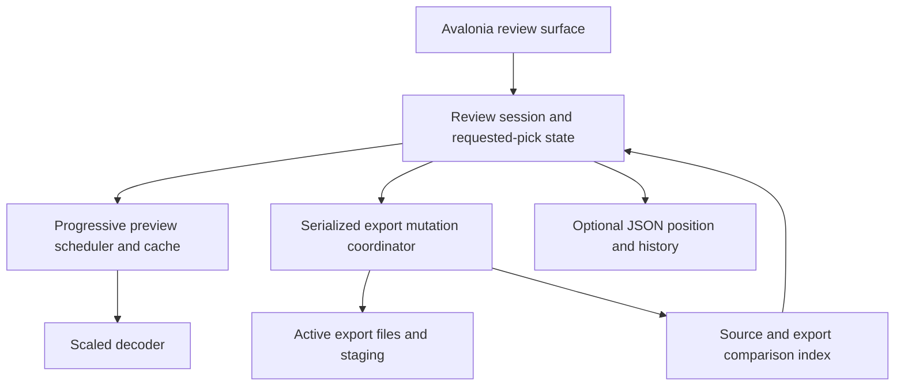

# Architecture and technology plan

Updated 2026-11-06 for the [core specification](README.md) and [legacy-compatible export format](legacy-export-format.md). This supersedes the SQLite/immutable-snapshot and source-relative destination plans: sources are read-only, designated exports are mutable, and completed export files determine picks. [Roadmap](implementation-roadmap.md), [contract](implementation-contract.md) and [acceptance criteria](acceptance-criteria.md) define implementation and proof.

## Technology choices

| Concern | Choice | Purpose |
| --- | --- | --- |
| Runtime | C#/.NET 10 | Shared Windows/macOS logic; installed Windows SDK 10.0.303 can seed the build pin. |
| Desktop UI | Avalonia + `CommunityToolkit.Mvvm` | Shared keyboard-focused UI, virtualized thumbnails, large fit-to-space preview. |
| Imaging | Scaled JPEG/PNG decoding through SkiaSharp initially | Cross-platform low-preview/full-refinement pipeline. Optional WIC/ImageIO adapters are justified only by benchmark results. |
| Persistence | Ordinary export photos; optional `System.Text.Json` review file | No database. Final copies recover picks; JSON stores disposable position/history/cache conveniences. |
| Scheduling | Bounded .NET channels/fixed workers and a desired-state map keyed by resolved export association | Priority previews, per-photo pending requests until association is known, coalesced mutations, no task-per-file allocation. |
| File operations | .NET streams, MD5 for legacy naming, SHA-256 for verification, small native path/publication/lock adapters | One streamed source copy computes both digests; protected reads, no-clobber publication and targeted export deletion. |
| Tests/diagnostics | xUnit, `Stopwatch`/`EventSource`, real-window performance runner | Measure actual keyboard/preview latency, queues, copy throughput, and source safety. |
| Distribution | Self-contained `win-x64`, macOS `.app` initially `osx-arm64` | Matching native image libraries; sign/notarize Mac distribution. Intel Mac support requires its own build/test profile. |

Resolve compatible stable Avalonia/SkiaSharp/toolkit/test package versions in P-01, then centrally pin them and commit NuGet lock files. No database package/native SQLite library is required. No implementation or cross-platform benchmark has been run yet.

## Component boundaries



Three shared projects suffice, with platform adapters isolated within Infrastructure:

```text
src/PhotoScreener.Core/             # IDs, focus/filter rules, operation generations
src/PhotoScreener.Infrastructure/   # read-only source, export mutation, indexing, JSON
src/PhotoScreener.Desktop/          # Avalonia UI, scheduler/cache/decoder composition
tests/PhotoScreener.Core.Tests/
tests/PhotoScreener.Infrastructure.Tests/
tests/PhotoScreener.Desktop.Tests/
tests/PhotoScreener.Performance/
```

Core has no UI/filesystem dependency. Infrastructure exposes `IReadOnlySource`, `IExportStore`, `IFolderComparer`, and optional `IReviewMetadataStore`; its Windows/macOS adapters contain native calls. `IExportStore` exposes staging, publication, associated-file deletion and owned-temp cleanup, never generic recursive delete. Image assets are owned immutable native-backed objects with explicit disposal; no WPF types remain.

`ReviewSession` owns UI-thread focus, filters, lightweight metadata and requested state. `ExportBindingResolver` supplies each folder's default `export` child or retained explicit override. `LegacyExportName` implements the exact stem/MD5-Base64 suffix/extension contract, with golden vectors. `ExportMutationCoordinator` owns per-association serialization, monotonic request ordering and completion generations. `FolderComparer` owns observed file associations, revision-checked checksum cache and index generations. Neither comparison nor optional JSON overrides a newer requested mutation. `PreviewScheduler` owns fixed workers/requests, and `PreviewCache` owns image lifetimes/byte budgets.

## Hot paths and initial budgets

Left/Right performs an in-memory focus change and displays a cached low preview or Loading. Space captures the focused photo/context and flips requested state immediately, with Copying/Removing feedback. It keeps the photo and refinement request unchanged. No source read, checksum, copy, deletion, folder rescan or metadata write runs synchronously in either handler.

Use Avalonia recycling/virtualized item presentation with a bounded visible region; verify its actual realized-control count. Keep active-folder metadata in memory and stream large Picked views. Orientation and physical-pixel fit are identical for low/full stages. Refinement uses original image detail at the display's required resolution, not unnecessary native-size neighbor bitmaps.

### Visible-first folder opening

`VisibleRangeTracker` observes the laid-out thumbnail viewport and focused photo and sends range generations to `PreviewScheduler`. Directory discovery publishes lightweight row batches first; only visible rows request images urgently. The initial preview/strip uses placeholders rather than waiting for full-folder decode or export comparison.

| Scheduling class | Work |
| --- | --- |
| UI input/render | Always responsive; workers never wait on synchronous UI calls. |
| First images | Focused quick preview, then currently visible thumbnail cache reads/decodes. |
| Review continuation | Focused full-quality refinement and near-neighbor quick previews; fair scheduling prevents refinement starvation. |
| Relaxed folder warming | Remaining low-resolution thumbnails, generated gradually while urgent queues are quiet. |
| Other background work | Comparison checksums, copy/verify chunks and optional metadata/cache writes, yielding to visible review work. |

Scrolling/keyboard changes promote the new viewport and discard old urgent offscreen requests. A bounded `FolderThumbnailWarmer` walks the remainder of the active folder lazily; it does not submit one task per photo. It stops on context change and backs off when interaction or resource pressure would miss the performance gates. Folder warming can pause; it is never a completion barrier for opening, navigating or picking.

Persist compressed thumbnail artifacts in an optional local disk cache so warming does not require all bitmaps to stay in RAM. Initial disk-cache budget is 512 MiB, separate from the 192 MiB decoded RAM budget and the 512 MiB process working-set gate. Cache keys include source identity/path/revision, size, orientation and decoding policy. Cache writes/eviction run at relaxed priority; missing/corrupt artifacts trigger lazy regeneration. Full-quality images are still decoded only for the focused photo. Local cache storage uses the platform cache directory and is independent of exported picks.

| Resource | Benchmark starting value |
| --- | --- |
| Decode workers | Two: urgent focused/visible work plus bounded refinement/prefetch/lazy warming; tune fair scheduling against gates. |
| Low preview | Roughly 640–1024 pixels on the longest oriented side. |
| Adjacent prefetch | ±2, favoring navigation direction. |
| Decoded cache | 192 MiB, with a separate transient allocation bound; total process gate ≤512 MiB. |
| Foreground request queue | Latest low-preview request only; superseded work replaced. |
| Secondary image queue | Deduplicated bounded set, initially ≤32 requests; folder warmer supplies work gradually, not a whole-folder backlog. |
| Export worker | One serialized mutation worker, initially 1 MiB reusable copy/verification buffer. |
| Pending mutations | Latest desired state for each photo, bounded initially to 1024 photos. |

After low preview publication, schedule refinement immediately if focus still matches; do not add a fixed dwell delay. All results carry context, photo/revision and request generation. Native cancellation may be delayed, so bound in-flight work and discard obsolete results rather than spawning replacement threads. Background comparison hashes/copy chunks yield to foreground image requests.

Prioritize the initial visible low-resolution tiles while keeping refinement eligible; do not make current full quality wait for every visible image when one is slow or broken. Publish small dispatcher batches at background/render-safe priorities and apply platform background worker priority where supported. No cache decode, EXIF walk or whole-folder control creation happens on the UI dispatcher.

Image queues coalesce obsolete requests. Mutation queues coalesce current desired state: pick→unpick before publication can discard the staging copy; unpick→pick during a completed deletion can schedule a new copy. An older worker completion cannot present its state as the latest result. If capacity is exhausted, show an explicit pending-operation limit/error while allowing navigation; never silently drop an accepted request.

## Folder-based picks and optional metadata

Build source IDs, per-folder export bindings and immediate-file target indexes incrementally. Only final eligible files count; ignore `.photoscreener`. Default binding is `<reviewedFolder>/export`, and writes are flat as `<originalStem>.<hash4><originalExtension>`, exactly matching the old app. Do not create a source-relative export hierarchy or rename existing files. Default per-folder targets keep same-named photos independent; an explicit shared target can share a pick only for equal original names and verified identical bytes. Keep shared rows consistent and reject unresolved case/Unicode or different-content suffix collisions.

Original filename/length narrow matches, considering unchanged and possible stripped-suffix names; retain all candidates. Background full checksums resolve unverified content, and the short hash is never identity by itself. Cache verified association against both file revisions so warm open does not rehash every export. If the cache is absent, revalidate in background: the image opens first, and candidate pick state stays Checking until known. A complete target index with no candidate can establish Unpicked without reading every source photo's bytes. Failed/unavailable scans do not yield false Unpicked. Store checksum cache in optional JSON only as a hint; it is never trusted after revision change.

Watchers trigger targeted reconciliation and rebuild after overflow. On open/Refresh/reconnection rescan relevant folders; after a successful mutation refresh just the affected association. Project Picked results stream from each folder's effective target index, deduplicating shared targets, with progressive totals and unavailable-source entries marked. Never compare all folders against one last-active target. No full source-tree walk occurs on every keypress or pick.

The optional review file resides at `effectiveExport/.photoscreener/review.json`. Write a new metadata temporary file, flush and atomically replace it asynchronously. Store root/binding hints, cursors/filter, reviewed history and cache fingerprints, not a picked ledger. Missing/corrupt metadata falls back to default binding/position or explicit custom-target selection and then comparison. Failed optional writes must not turn completed copies into lost selections. Small per-folder metadata files may replace a large JSON document if benchmarks justify it; either layout remains optional.

## Protected mutation boundary

Resolve the reviewed folder's existing/default `export` target or explicit override; create a missing target lazily on first pick. Reject a root equal to or containing protected sources. Exclude `export` subtrees and designated custom targets from the protected source set before enabling mutations; validate disjoint canonical protected-source and mutation paths. Hold writer ownership for each target with accepted pending work. Folder navigation does not wait for those jobs; changes to an affected binding or project/close finish or explicitly cancel them. Queued jobs retain their original pairing and cannot be redirected by later folder navigation.

For a pick, reserve a unique file under `.photoscreener/staging`, stream original bytes while computing MD5 and SHA-256 in one source pass, flush and verify the staging output, then publish atomically to the exact legacy name with no-clobber semantics. No final-path partial copy is exposed. Reuse an existing path only after verifying identical bytes; a different-content collision is an explicit error without overwrite or alternate suffix. Changed source versions leave older exports intact. If the latest request is unpicked, discard staging or follow a just-completed publication with the serialized remove action.

For an unpick, validate the association's current-version target paths, boundary and regular-file identities, then delete only those verified copies in the captured root. Confirm Unpicked only when no associated copy remains; locked, substituted or unknown targets are Error/Checking. Duplicate verified copies must not resurrect a completed unpick. Do not recursively clean directories, older exported versions or unmatched photos. Cleanup is restricted to known app-owned staging/metadata files inside designated roots.

Windows and macOS adapters provide atomic publication, file/directory identity, no-follow path validation and process ownership locks. Protect source paths from symlink/junction/hard-link aliases. Windows can exclude source writes through read-handle sharing. On macOS recheck revisions around copying; fail on detected changes without claiming ordinary locks prevent arbitrary external writers. [Platform details](macos-support.md) define remaining differences.

Copy/delete completion is recorded by actual filesystem observation, not a database acknowledgement. A crash during staging leaves recoverable final picks and non-pick temporary files. A crash before a requested removal completes can leave the copy Picked; the UI must have shown Removing rather than falsely confirming Unpicked. An unfinished in-memory request is not guaranteed to survive a crash.

## Proof and handoff

Implement a fresh shared UI alongside the legacy code; do not carry the old MainWindow partial classes, AI models/dependencies or TV code into the new build. Benchmark the keyboard/preview slice before expanding it. Then add mutation/recovery tests using real temporary source/export trees and compare all source bytes/paths before and after.

Test exact legacy naming, old-helper read-back of new writes, default/custom/shared folder bindings, native publication, concurrent toggle/context changes, path aliases, target locks, failed copies, source edits, external export changes and interruption. Kill a child process during staging and after publication/deletion; recover old/new picks from files with all optional metadata removed. Verify performance on Windows and macOS under active copying/deletion/hash load. Record frame-submission timing separately from physical-display claims and copy throughput separately from input feedback.
